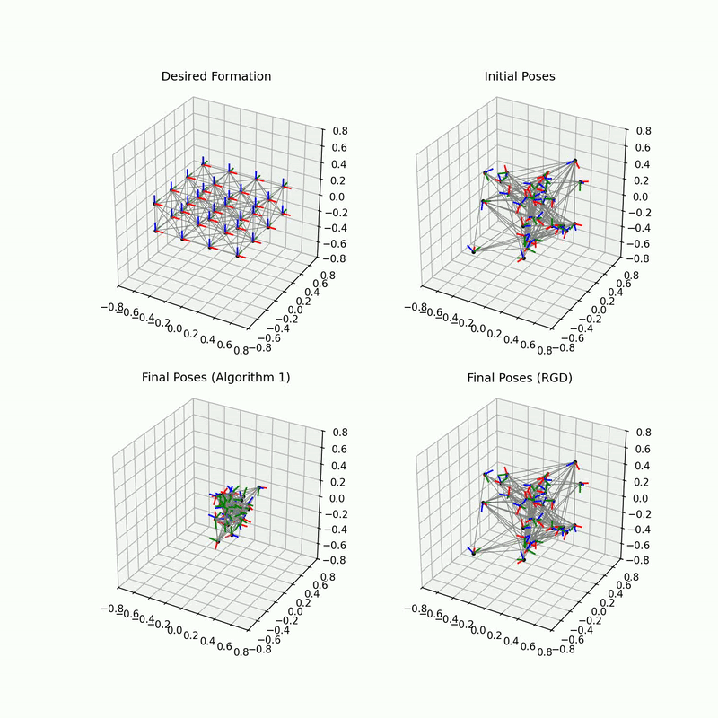
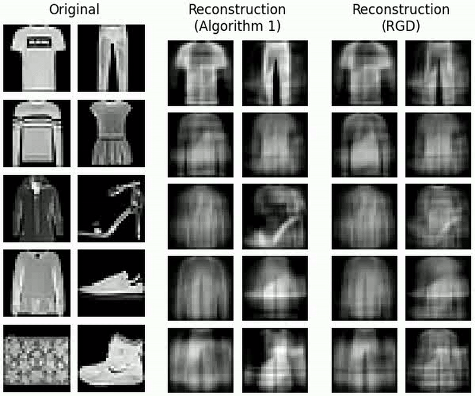

# Asynchronous Optimization on Manifolds
[](LICENSE)

This repository is associated with a paper currently under review for [ECC (European Controls Conference) 2027](https://ecc27.euca-ecc.org/).

It simulates distributed Riemannian optimization on product manifolds under partial asynchrony. 
Each agent owns one block of the variable, takes Riemannian gradient steps on its block, and communicates with the other agents only occasionally, using whatever (possibly stale) values it last received. 
Every simulation compares our algorithm against a baseline (synchronous Riemannian gradient descent), whose agents experience the same computation and communication delays and thus have to use synchronization barriers each iteration.

We consider two example problems:

- **Formation control:** robots on $(\mathbb{R}^{3} \times S^{3})^{N}$ (position plus unit quaternion) move into a desired formation using a rotation-invariant, pseudo-Huber objective.
- **Dictionary learning:** complete dictionary learning on the oblique manifold, applied to whitened Fashion-MNIST images, with the dictionary's columns split among the agents.

## Visuals

<!-- **Formation control**



**Dictionary learning**

 -->

<table>
  <tr>
    <td align="center" width="45.59%"><br><em>Formation control</em></td>
    <td align="center" width="54.41%"><br><em>Dictionary learning</em></td>
  </tr>
</table>


## Getting started

We recommend using a Python virtual environment.
```bash
# Clone repository
git clone https://github.com/pooleya19/asynch-opt-on-manifolds-py.git
cd asynch-opt-on-manifolds-py

# Create virtual environment
python3 -m venv .venv
source .venv/bin/activate

# Install dependencies
pip install -r requirements.txt
pip install -e .
```

## Running the simulations

Each problem has its own folder under `src/asynch_opt_on_manifolds/`:

| Script | What it does |
|---|---|
| `Sim.py` | Runs a single simulation with a live plot |
| `BulkSims.py` | Runs the paper's batch of experiments in parallel, saving results to `data/` (SLOW, 5+ hours on 16 cores) |
| `GeneratePlots.py` | Turns the batch results into the paper's figures, saved to `figures/` |

Simulation parameters (number of agents, communication interval, step size, etc.) are set in the `__main__` block of `Sim.py` and in `main()` of `BulkSims.py`. The `data/` and `figures/` folders are created when a script saves to them and are not tracked by git.

### Formation control

For a single simulation with a live plot, run
```bash
python src/asynch_opt_on_manifolds/RobustFormationControl/Sim.py
```

For all simulations and figure generation, run 
```bash
python src/asynch_opt_on_manifolds/RobustFormationControl/BulkSims.py
python src/asynch_opt_on_manifolds/RobustFormationControl/GeneratePlots.py
```

### Dictionary learning

The dictionary learning simulations require a dataset to learn. This script downloads Fashion-MNIST (and a few smaller datasets) and saves them to `data/dictionary_dataset/`:

```bash
python src/asynch_opt_on_manifolds/CompleteDictionaryLearning/GenerateData.py
```

For a single simulation with a live plot, run
```bash
python src/asynch_opt_on_manifolds/CompleteDictionaryLearning/Sim.py
```

For all simulations and figure generation, run 
```bash
python src/asynch_opt_on_manifolds/CompleteDictionaryLearning/BulkSims.py
python src/asynch_opt_on_manifolds/CompleteDictionaryLearning/GeneratePlots.py
```